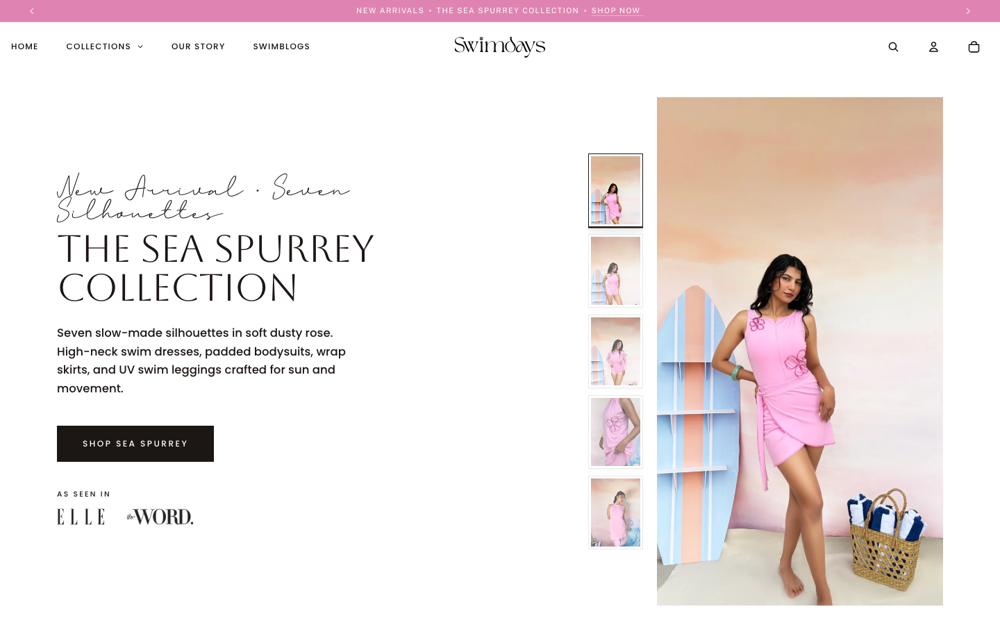

# Swimdays Atelier | High-Performance Shopify OS 2.0 Storefront

<div align="center">
  
</div>

<div align="center">
  <h3>
    <a href="https://shopswimdays.com">Live Storefront</a>
    <span> | </span>
    <a href="https://github.com/shubhktr1012/swimdays-web">GitHub Repository</a>
  </h3>
</div>

---

## Overview

Swimdays Atelier is a production-grade Shopify Online Store 2.0 e-commerce storefront crafted for an artisanal swimwear label. The project couples bespoke Liquid architecture with modern web performance optimizations, automated visual regression tests, and seamless marketing automation.

---

## Core Engineering Features

* **Shopify OS 2.0 Liquid Architecture:** Modular sections, reusable snippets, and flexible JSON templates allowing full merchant customizability in the Shopify Theme Editor.
* **Performance Budget (Sub-1.8s LCP):** Hand-optimized asset loading, responsive WebP image pipelines, critical CSS inlining, and lazy-loaded media ensuring top tier Core Web Vitals.
* **Dynamic Cart Experience:** Asynchronous cart drawer interacting directly with the Shopify Ajax Cart API for frictionless additions and quantity adjustments without page reloads.
* **Klaviyo Marketing Automation:** Direct API integration for subscriber capture, custom events, and tailored email template rendering.
* **Visual Regression & QA:** Automated Playwright test suite capturing multi-viewport screenshots (desktop 1920/1440, tablet 820, mobile 390) to guarantee responsive fidelity across deployments.

---

## Tech Stack

* **Templating & Logic:** Shopify Liquid, HTML5, Semantic Elements
* **Styling & Interaction:** Modern CSS3 (Grid, Flexbox, CSS Variables), Vanilla JavaScript (ES6+)
* **Testing & Automation:** Playwright, Node.js
* **Deployment:** Vercel Edge Network

---

## Local Development

1. Clone the repository:
```bash
git clone https://github.com/shubhktr1012/swimdays-web.git
```

2. Open the project root or run a local static server:
```bash
npx serve .
```

3. Visit `http://localhost:3000` or check the live storefront at `https://shopswimdays.com`.
